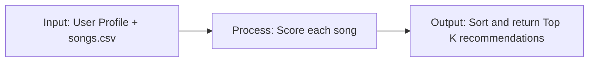

# 🎵 Music Recommender Simulation

## Project Summary

In this project you will build and explain a small music recommender system.

Your goal is to:

- Represent songs and a user "taste profile" as data
- Design a scoring rule that turns that data into recommendations
- Evaluate what your system gets right and wrong
- Reflect on how this mirrors real world AI recommenders

This project demonstrates an explainable, content-based music recommender wrapped
in a small curator agent. The agent validates profiles, retrieves local editorial
context, selects a scoring strategy, checks list diversity, estimates confidence,
and writes a structured trace.

---

## How The System Works

Real-world recommendation systems often combine collaborative filtering, which finds patterns in what similar users listen to or enjoy together, with content-based filtering, which matches a user's preferences to song attributes. They can learn from explicit signals such as likes and saves, and implicit signals such as plays, skips, replays, and playlist additions, alongside audio or catalog features. This simulation will focus on content-based recommendations: it compares each song's genre, mood, and audio characteristics with a user's stated taste profile, rather than learning behavior patterns across many users.

- **`Song` fields** (from `data/songs.csv`): `id`, `title`, `artist`, `genre`, `mood`, `energy`, `tempo_bpm`, `valence`, `danceability`, `acousticness`, `popularity`, `release_decade`, `detailed_mood_tags`, `key`, and `time_signature`. The added metadata expands matching beyond the original genre, mood, and audio attributes.
- **Example user preferences**: `{"genre": "rock", "mood": "intense", "energy": 0.90, "target_tempo_bpm": 150, "popularity": 80, "release_decade": 2020, "detailed_mood_tags": ["defiant", "intense"]}`. Every preference is optional; unspecified features do not affect a score.
- **Balanced scoring recipe (100 points for the original features)**:
  - Genre match: **30 points**; mood match: **25 points**. An exact match earns full points; otherwise it earns zero.
  - Numerical proximity: energy **15**, tempo **10**, valence **8**, danceability **7**, and acousticness **5** points maximum per feature.
  - For each numerical feature `f`, calculate `P_f = max(0, 1 - abs(song_f - target_f) / (max_f - min_f))`, where `min_f` and `max_f` are that feature's catalog bounds. Add `weight_f * P_f` points. This rewards closeness to the target, not simply higher or lower values.
- **Scoring modes**: `balanced`, `genre_first`, `mood_first`, and `energy_focused` use different strategy weights. Additional metadata preferences (popularity, decade, mood tags, key, and time signature) contribute only when supplied in the profile.
- **Ranking Rule**: greedily select the highest effective score for each rank. Once an artist is selected, subsequent songs by that artist receive a 0.5-point diversity penalty.



**Potential biases:** Genre weights may over-prioritize a single style and narrow discovery. The local knowledge base and catalog are small and curated, so they can skew which genres and moods are represented. Exact genre and mood matching can also miss appealing cross-genre songs. A post-ranking guardrail checks whether one genre or artist exceeds 60% of the requested list and triggers a rerank when possible.

The curator flow is: sanitize profile inputs, choose a strategy, retrieve matching
editorial notes from `data/music_knowledge.json`, add retrieved mood tags to the
scoring profile, rank with `recommend_songs()`, critique diversity, and record
confidence plus step-by-step details in `logs/agent_trace.json`.

---

## Getting Started

### Setup

1. Create a virtual environment (optional but recommended):

   ```bash
   python -m venv .venv
   source .venv/bin/activate      # Mac or Linux
   .venv\Scripts\activate         # Windows

2. Install dependencies

```bash
pip install -r requirements.txt
```

3. Run the app:

```bash
python -m src.main
```

The default run evaluates focused-study, workout, and conflicting heartbreak
profiles. It prints each plan, retrieved context, guardrail result, confidence
score, and recommendation table. The structured trace is written to
`logs/agent_trace.json`.

### Running Tests

Run the starter tests with:

```bash
pytest
```

You can add more tests in `tests/test_recommender.py`.

---

## Sample Recommendation Output

Excerpt from the default run showing the energy-focused table and repeat-artist explanation:

```text
Loaded 18 songs.

Profile: Metal preference, happy mood, high energy

Energy Focused - Top recommendations:
+------+------------------+----------------+-------+-------------------------------------------------------------------------------------------------------------------------------------------------+
| Rank | Title            | Artist         | Score | Reasons                                                                                                                                         |
+------+------------------+----------------+-------+-------------------------------------------------------------------------------------------------------------------------------------------------+
| 1    | Sunrise City     | Neon Echo      | 59.02 | mood match (+10.0); energy proximity (+43.18); popularity proximity (+1.84); release_decade proximity (+2.00); detailed mood tags match (+2.00) |
| 2    | Iron Horizon     | Black Meridian | 56.29 | genre match (+15.0); energy proximity (+38.31); popularity proximity (+1.98); release_decade proximity (+1.00)                                  |
| 3    | Rooftop Lights   | Indigo Parade  | 53.74 | mood match (+10.0); energy proximity (+39.53); popularity proximity (+1.88); release_decade proximity (+1.00); detailed mood tags match (+1.33) |
| 4    | Neon Pulse       | Vector Bloom   | 48.86 | energy proximity (+43.78); popularity proximity (+1.74); release_decade proximity (+2.00); detailed mood tags match (+1.33)                     |
| 5    | Paper Crown      | Static Youth   | 46.23 | energy proximity (+42.57); popularity proximity (+2.00); release_decade proximity (+1.00); detailed mood tags match (+0.67)                     |
| 6    | Gym Hero         | Max Pulse      | 44.58 | energy proximity (+40.14); popularity proximity (+1.78); release_decade proximity (+2.00); detailed mood tags match (+0.67)                     |
| 7    | Storm Runner     | Voltline       | 44.33 | energy proximity (+41.35); popularity proximity (+1.98); release_decade proximity (+1.00)                                                       |
| 8    | Night Drive Loop | Neon Echo      | 42.36 | energy proximity (+38.92); popularity proximity (+1.94); release_decade proximity (+2.00); diversity penalty (-0.50: repeat artist)             |
+------+------------------+----------------+-------+-------------------------------------------------------------------------------------------------------------------------------------------------+
```

**Screenshot or video** *(optional)*: <!-- Insert a screenshot or demo video link here -->

---

## Experiments You Tried

Use this section to document the experiments you ran. For example:

- What happened when you changed the weight on genre from 2.0 to 0.5
- What happened when you added tempo or valence to the score
- How did your system behave for different types of users

---

## Limitations and Risks

Summarize some limitations of your recommender.

Examples:

- It only works on a tiny catalog
- It does not understand lyrics or language
- It might over favor one genre or mood

You will go deeper on this in your model card.

---

## Reflection

Read and complete `model_card.md`:

[**Model Card**](model_card.md)

Write 1 to 2 paragraphs here about what you learned:

- about how recommenders turn data into predictions
- about where bias or unfairness could show up in systems like this


