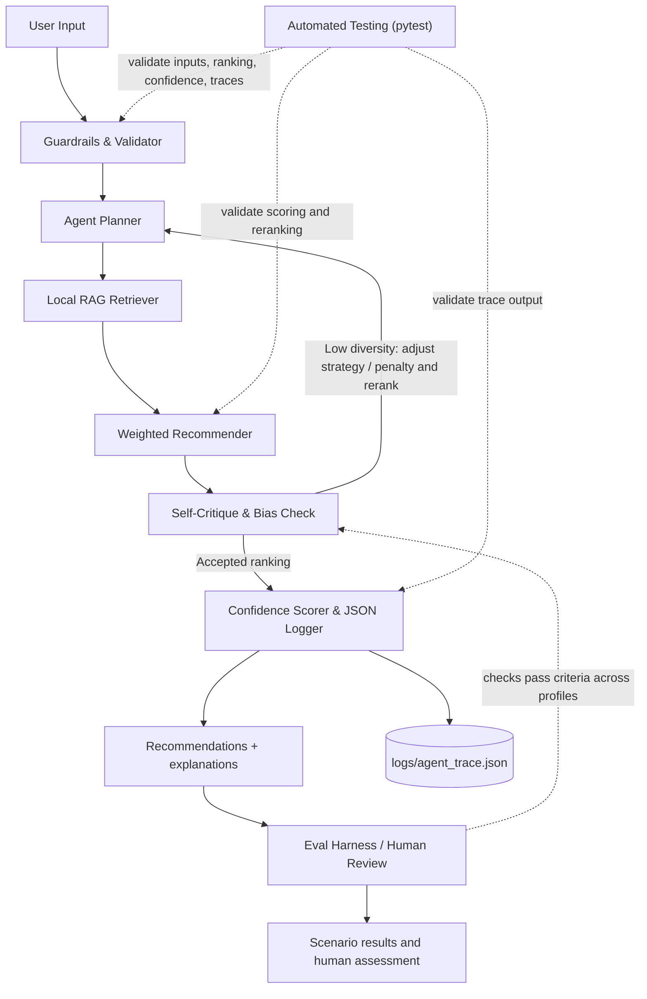

# Applied AI System: Explainable Music Curator

## Base Project Attribution

This project builds on the original Module 3 project, **Music Recommender Simulation**. The base project introduced a content-based recommender that represents songs and user taste profiles, scores matches with understandable rules, and asks learners to evaluate the results and reflect on bias. The upgraded system preserves that foundation while adding profile guardrails, local retrieval-augmented context, an agentic ranking and critique loop, confidence reporting, structured traces, and an automated evaluation harness.

## Title & Summary

The Applied AI System is a deterministic music-curation agent over a small, local catalog. It validates preferences, retrieves relevant editorial guidance, selects a weighted scoring strategy, ranks and explains songs, checks recommendation diversity, reports a heuristic confidence score, and records its work as JSON. This matters because a recommendation can be inspected and challenged at each step instead of being presented as an unexplained result.

## Architecture Overview

The architecture moves from user input through validation, planning, local RAG, and weighted ranking. A self-critique step checks genre and artist concentration and can rerank with a different scoring strategy and repeat-artist penalty. Confidence and JSON tracing capture the result; pytest, the scenario harness, and human review check different aspects of system quality.

See the standalone [Mermaid architecture diagram](diagrams/architecture.mmd).



## Setup Instructions

Clone the repository, install dependencies, and run the application, evaluation harness, and tests:

```bash
git clone https://github.com/somtoEdoka/applied-ai-system-final.git
cd applied-ai-system-final
python -m venv .venv
source .venv/bin/activate
python -m pip install -r requirements.txt
python -m src.main
python -m src.eval_harness
python -m pytest -v
```

The CLI uses the bundled song catalog and local knowledge JSON. It does not need
an API key or network access after dependencies are installed.

## Reproducible Execution Evidence / Sample Interactions

The outputs below were captured by running the exact commands shown. The main
application demonstrates two ordinary profiles and one conflicting edge case.

### End-to-end Agent Run

Command:

```bash
python -m src.main
```

Output:

```text
Loaded 18 songs.

Profile: Focused study
Plan: strategy=balanced; retrieval query='lofi focused study'
Retrieved RAG context:
  - [genre: lofi] Lo-fi's restrained dynamics and soft textures can make it a comfortable background for focused work; lyrics and repetition still affect individual listeners.
  - [scenario: study] A study playlist may benefit from steady pacing and low distraction. Instrumental or familiar tracks can help some people maintain focus.
  - [general: music listening] Musical preferences are personal; treat this catalog's matches as suggestions and keep room for discovery.
  Contextual scoring tags: focused, calm, introspective
Guardrail action: No adjustment required.
Final guardrail: passed
Confidence: 0.91 (margin=0.75, coverage=1.00, input reliability=1.00)
+------+---------------------+----------------+-------+----------------------------------------------------------------------------------------------------------------------------+
| Rank | Title               | Artist         | Score | Reasons                                                                                                                    |
+------+---------------------+----------------+-------+----------------------------------------------------------------------------------------------------------------------------+
| 1    | Focus Flow          | LoRoom         | 80.00 | genre match (+30.0); mood match (+25.0); energy proximity (+15.00); detailed mood tags match (+10.00)                      |
| 2    | Midnight Coding     | LoRoom         | 50.76 | genre match (+30.0); energy proximity (+14.59); detailed mood tags match (+6.67); diversity penalty (-0.50: repeat artist) |
| 3    | Library Rain        | Paper Lanterns | 43.99 | genre match (+30.0); energy proximity (+13.99)                                                                             |
| 4    | Blue Note Alley     | Low Lantern    | 17.52 | energy proximity (+14.19); detailed mood tags match (+3.33)                                                                |
| 5    | Coffee Shop Stories | Slow Stereo    | 14.39 | energy proximity (+14.39)                                                                                                  |
+------+---------------------+----------------+-------+----------------------------------------------------------------------------------------------------------------------------+

Profile: Workout
Plan: strategy=energy_focused; retrieval query='pop intense workout'
Retrieved RAG context:
  - [scenario: workout] Workout selections often benefit from a clear pulse and energy that fits the activity, with intensity adjusted to the listener's preference.
  - [general: music listening] Musical preferences are personal; treat this catalog's matches as suggestions and keep room for discovery.
  Contextual scoring tags: energetic, driving, confident
Guardrail action: No adjustment required.
Final guardrail: passed
Confidence: 0.85 (margin=0.58, coverage=1.00, input reliability=1.00)
+------+--------------+--------------+-------+------------------------------------------------------------------------------------------------------+
| Rank | Title        | Artist       | Score | Reasons                                                                                              |
+------+--------------+--------------+-------+------------------------------------------------------------------------------------------------------+
| 1    | Gym Hero     | Max Pulse    | 69.51 | genre match (+15.0); mood match (+10.0); energy proximity (+43.18); detailed mood tags match (+1.33) |
| 2    | Sunrise City | Neon Echo    | 55.80 | genre match (+15.0); energy proximity (+40.14); detailed mood tags match (+0.67)                     |
| 3    | Storm Runner | Voltline     | 55.06 | mood match (+10.0); energy proximity (+44.39); detailed mood tags match (+0.67)                      |
| 4    | Paper Crown  | Static Youth | 45.06 | energy proximity (+44.39); detailed mood tags match (+0.67)                                          |
| 5    | Neon Pulse   | Vector Bloom | 43.84 | energy proximity (+43.18); detailed mood tags match (+0.67)                                          |
+------+--------------+--------------+-------+------------------------------------------------------------------------------------------------------+

Profile: Adversarial: heartbreak with high energy
Input validation: Clamped energy to the range 0.0–1.0.; Ignored unknown profile field: unexpected_field.; Genre 'shoegaze' is not present in the catalog.; Mood 'sad' is not present in the catalog.; High energy conflicts with the requested sad mood.
Plan: strategy=energy_focused; retrieval query='shoegaze sad heartbreak'
Retrieved RAG context:
  - [mood: sad] For heartbreak or sadness, some listeners prefer music that validates the mood while others prefer a gradual shift toward comfort; avoid assuming one response fits everyone.
  - [scenario: heartbreak] Heartbreak listening can be reflective or uplifting depending on what the listener wants; offer emotionally varied choices rather than prescribing a mood.
  - [general: music listening] Musical preferences are personal; treat this catalog's matches as suggestions and keep room for discovery.
  Contextual scoring tags: reflective, introspective, melancholic, hopeful
Guardrail action: No adjustment required.
Final guardrail: passed
Confidence: 0.30 (margin=0.15, coverage=0.33, input reliability=0.50)
+------+--------------+----------------+-------+---------------------------+
| Rank | Title        | Artist         | Score | Reasons                   |
+------+--------------+----------------+-------+---------------------------+
| 1    | Iron Horizon | Black Meridian | 42.57 | energy proximity (+42.57) |
| 2    | Gym Hero     | Max Pulse      | 40.74 | energy proximity (+40.74) |
| 3    | Storm Runner | Voltline       | 39.53 | energy proximity (+39.53) |
| 4    | Paper Crown  | Static Youth   | 38.31 | energy proximity (+38.31) |
| 5    | Neon Pulse   | Vector Bloom   | 37.09 | energy proximity (+37.09) |
+------+--------------+----------------+-------+---------------------------+

Structured agent trace written to /workspaces/applied-ai-system-final/logs/agent_trace.json
```

### Evaluation Harness

Command:

```bash
python -m src.eval_harness
```

Output:

```text
| Scenario | Status | Guardrail (expected / actual) | Top-K | Confidence | Details |
|---|---|---|---:|---:|---|
| Normal study profile | PASS | False / False | PASS | 0.9108 | All criteria passed |
| Normal workout profile | PASS | False / False | PASS | 0.8524 | All criteria passed |
| Conflicting sad/high energy | PASS | True / True | PASS | 0.3790 | All criteria passed |
| Unknown genre | PASS | True / True | PASS | 0.0750 | All criteria passed |
| Empty profile | PASS | True / True | PASS | 0.0750 | All criteria passed |
| Extreme numeric values | PASS | True / True | PASS | 0.6531 | All criteria passed |
| Missing profile | PASS | True / True | PASS | 0.0750 | All criteria passed |

Overall pass rate: 7/7 (100.0%)
Average confidence score: 0.4315
```

### Automated Test Suite

Command:

```bash
python -m pytest -v
```

Output:

```text
============================= test session starts ==============================
platform linux -- Python 3.14.2, pytest-9.2.0, pluggy-1.7.0 -- /home/codespace/.python/current/bin/python
cachedir: .pytest_cache
rootdir: /workspaces/applied-ai-system-final
plugins: platformdirs-4.14.0, anyio-4.15.1
collecting ... collected 17 items

tests/test_agent.py::test_sanitize_profile_clamps_and_flags_conflict PASSED [  5%]
tests/test_agent.py::test_diversity_guardrail_flags_more_than_sixty_percent PASSED [ 11%]
tests/test_agent.py::test_agent_writes_trace_and_handles_empty_profile PASSED [ 17%]
tests/test_agent.py::test_agent_reranks_when_one_genre_dominates PASSED  [ 23%]
tests/test_applied_system.py::test_guardrails_clamp_numeric_values_and_detect_conflict PASSED [ 29%]
tests/test_applied_system.py::test_guardrails_handle_missing_or_empty_profiles[None] PASSED [ 35%]
tests/test_applied_system.py::test_guardrails_handle_missing_or_empty_profiles[profile1] PASSED [ 41%]
tests/test_applied_system.py::test_agent_runs_retrieves_rag_context_and_writes_json_trace PASSED [ 47%]
tests/test_applied_system.py::test_agent_self_critiques_and_reranks_low_diversity PASSED [ 52%]
tests/test_applied_system.py::test_agent_rankings_are_reproducible PASSED [ 58%]
tests/test_recommender.py::test_recommend_returns_songs_sorted_by_score PASSED [ 64%]
tests/test_recommender.py::test_explain_recommendation_returns_non_empty_string PASSED [ 70%]
tests/test_recommender.py::test_load_songs_parses_advanced_fields PASSED [ 76%]
tests/test_recommender.py::test_scoring_modes_can_change_rankings_for_the_same_profile PASSED [ 82%]
tests/test_recommender.py::test_advanced_preferences_add_scores_and_explanations PASSED [ 88%]
tests/test_recommender.py::test_recommend_songs_greedily_penalizes_repeat_artists PASSED [ 94%]
tests/test_recommender.py::test_ascii_table_is_bordered_and_aligned PASSED [100%]

============================== 17 passed in 0.09s ==============================
```

## Design Decisions

- **Deterministic local RAG:** The agent retrieves from a curated local JSON
  knowledge base. This avoids external service dependencies and API keys and
  makes the same input reproducible.
- **Modular scoring strategies:** Strategy weights are explicit and replaceable
  without duplicating the scoring loop.
- **Critique as a bounded correction:** A diversity finding triggers a
  deterministic rerank rather than an open-ended LLM call. It may still fail
  the concentration check when the catalog cannot supply varied results.
- **Heuristic, not probabilistic, confidence:** The reported score combines
  score margin, catalog match coverage, and input reliability. It is an
  inspectable signal, not a calibrated probability of user satisfaction.
- **Local evidence:** The harness checks representative input scenarios and
  emits measurable criteria; human review remains necessary to judge
  recommendation quality and responsible use.

## Testing Summary

The latest run passed **17/17 pytest tests** and **7/7 evaluation scenarios**.
The evaluation harness reported a **100% pass rate** and **0.4315 average
confidence** across its scenarios. The adversarial scenarios verified clamping,
conflict and fallback behavior, bounded confidence, and continued execution;
these contract checks do not prove subjective recommendation quality.

## Brief Reflection & Portfolio Note

This project demonstrates how I approach applied AI engineering: make the
decision path explainable, make failure cases testable, and keep model-like
outputs honest about their limits. I used deterministic components so another
person can reproduce the results and inspect the evidence, while documenting
where catalog size prevents a guardrail from fully correcting bias. See
[`model_card.md`](model_card.md) for the full responsible-AI reflection.
